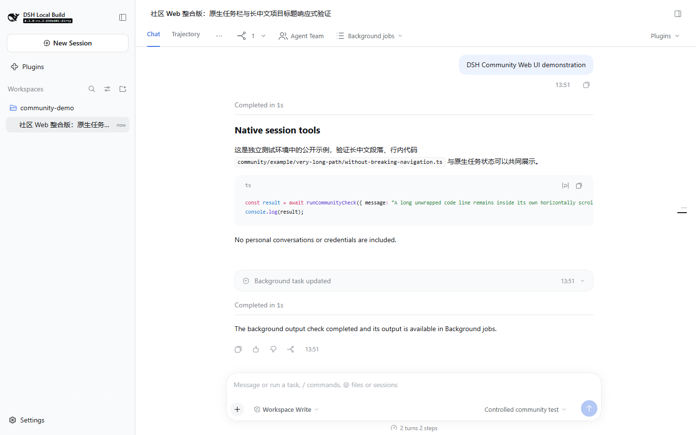
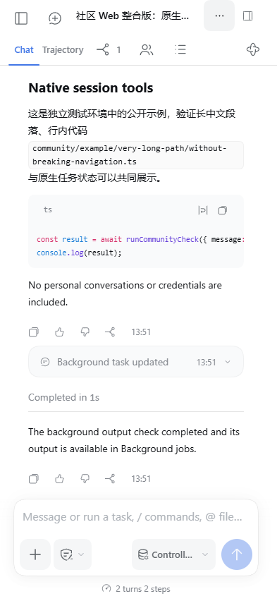

# DSH Community Web UI

English | [中文](README.zh.md)

An unofficial, independently maintained community source preview built on [DeepSeek Harness](https://github.com/deepseek-ai/deepseek-harness) by [DeepSeek AI](https://deepseek.com). This project integrates a responsive Web interface into the client source while retaining the upstream Desktop presentation. It does not claim official endorsement or acceptance upstream.

## Summary

The Web design groups conversation navigation, native session tools, and third-party extensions; improves mobile reading and composing; and keeps task state connected to the existing DSH services. The integration targets the upstream `dsh-v0.2.0-rc.2` source baseline. Check the [verification record](docs/community/verification.md) before relying on a feature or platform claim.

## Contents

- [Desktop and Web UI differences](#desktop-and-web-ui-differences)
- [Interface and features](#interface-and-features)
- [Screenshots](#screenshots)
- [Install and use](#install-and-use)
- [Contribute](#contribute)
- [Acknowledgements and license](#acknowledgements-and-license)
- [Contact and feedback](#contact-and-feedback)

## Desktop and Web UI differences

| Client | Intended presentation | Distribution |
| --- | --- | --- |
| Official Windows Desktop | Upstream icons, controls, and layout | The installed official application remains separate from this checkout |
| Community Web, desktop browser | Community navigation, taskbar, and reading layout | Built from this repository's Web client source |
| Community Web, mobile browser | The same community interface with responsive controls | The Web server serves the same client to the phone |

The community Web build does not require a separate UI beautification plugin, browser extension, or manual CSS injection. DSH's own Cordis modules and third-party plugin support remain part of the architecture. Installing the official Desktop application alone does not install this community Web edition. See [development and isolation](docs/community/develop.md) for the implementation and [verification](docs/community/verification.md) for what has actually been exercised.

## Interface and features

- Conversation and trajectory navigation stay separate from task controls.
- Subagents, agent teams, and background jobs keep their original data and actions; third-party taskbar contributions use the Plugins menu.
- Schedule entries remain distinct from background jobs. Approval, plan, goal, and workflow interfaces remain with their original owners.
- Mobile layout covers touch controls, the composer, Markdown, code blocks, and viewport changes; the Memory floating widget is outside this redesign.

The [user guide](docs/community/use.md) explains the controls and count semantics. Runtime screenshots and their exact test conditions belong in the [verification record](docs/community/verification.md); a mobile browser emulation is not an Android-device test.

## Screenshots

Actual community Web rendering from an isolated native runtime, using public demonstration data and a controlled LLM adapter. No external model request was made. The [verification gallery](docs/community/verification.md#screenshots) includes dark themes, running jobs, subagents, and the Plugins menu.

Mobile browser emulation — 393 × 852

These images do not establish Android-device or installed Windows Desktop acceptance.

## Install and use

Follow the [community installation guide](docs/community/install.md). It uses this repository's source build, not the separately published official npm package. Read the [safety notice](SAFETY.md) before connecting a model or exposing a server to another device.

Upstream documentation remains available at [the official documentation site](https://deepseek-harness.github.io/deepseek-harness/). The [upstream source README](https://github.com/deepseek-ai/deepseek-harness/blob/dsh-v0.2.0-rc.2/README.md) describes the unmodified project.

## Contribute

Start with the [community developer guide](docs/community/develop.md), then the [upstream architecture](docs/architecture.md) and [development guide](docs/development.md). The [upstream proposal](UPSTREAM_PROPOSAL.md) describes a possible future review; it does not imply that the official maintainers have agreed to merge the work. The current [upstream contribution policy](CONTRIBUTING.md) does not accept external pull requests.

## Acknowledgements and license

DeepSeek AI provides the upstream foundation. The earlier mobile adaptation work in [dsh-web](https://github.com/zhu1090093659/dsh-web) and [dsh-LAN](https://github.com/MrMu666/dsh-LAN) informed this project's design. [Acknowledgements](ACKNOWLEDGEMENTS.md) distinguishes that history from code included in this source edition.

The upstream [MIT License](LICENSE), original copyright, and [third-party notices](THIRD_PARTY_NOTICES.md) remain applicable. Acknowledgements do not replace license notices. Official brand materials do not indicate endorsement of this community edition.

## Contact and feedback

This is an independently maintained community project. Use this repository's Issues or Discussions, where enabled, for public technical reports; include the version, viewport, reproduction steps, and a redacted screenshot.

Email: 2466441707@qq.com

QQ: 2466441707

## Dev Note

The [community repository](https://github.com/sunrulin123/deepseek-harness) maintains the source preview on `community/default-web-ui`. This preview does not include an `.exe` installer or claim Android-device or installed Desktop acceptance. The verification record owns platform results and publication status.
