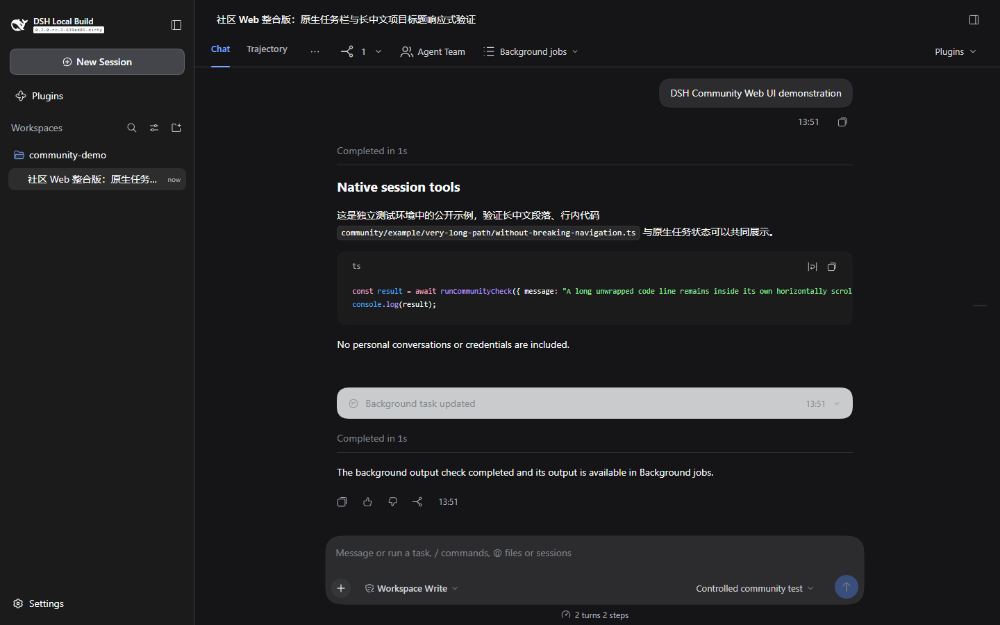
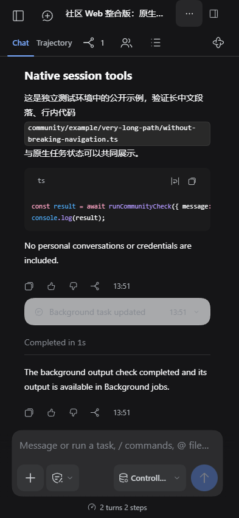
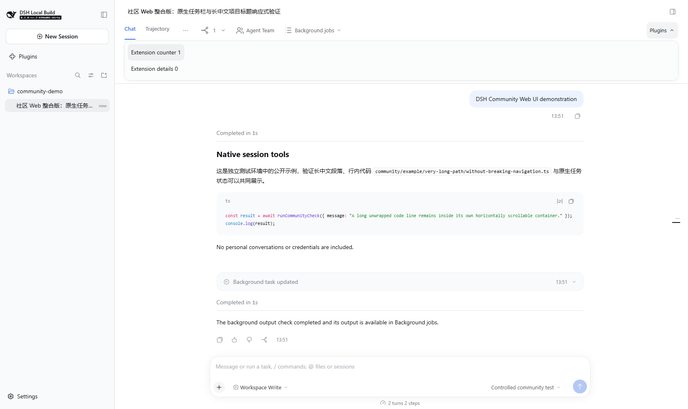
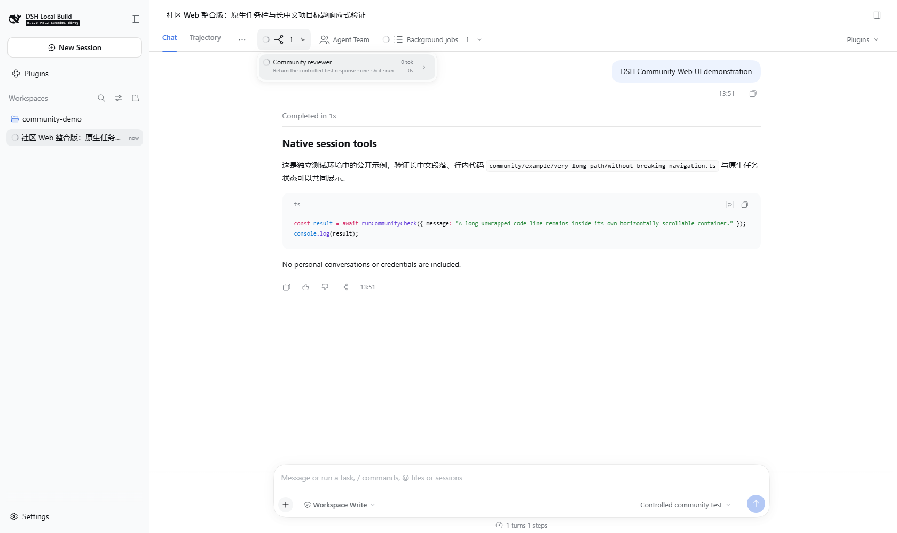
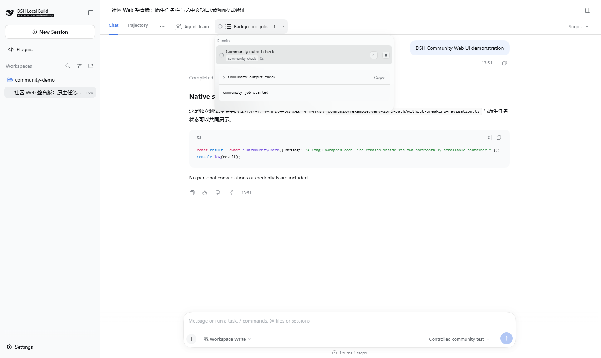
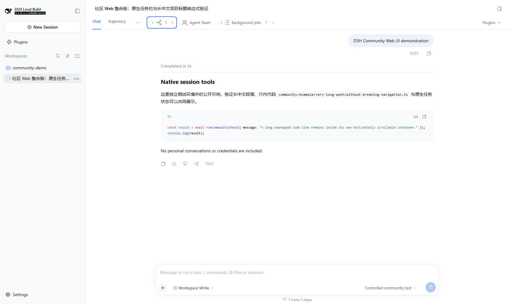

# Community edition verification record

English | [中文](verification.zh.md)

## Summary

This record distinguishes the native source edition from the earlier installed-plugin deployment. A previous plugin test does not verify the new source build. The table records checks actually performed for this edition and preserves their limits.

## Environment and result labels

The source baseline is the public `dsh-v0.2.0-rc.2` tag. Local dependency preparation used Windows and Node.js `24.21.0`. The original frozen installation kept the lockfile unchanged; the later sidebar accessibility fix adds one existing workspace dependency from ui-layout to ui-primitives, with its matching lockfile link and no external package or version change. The root manifest selects `pnpm@11.7.0`; dependency preparation initially ran with the installed `pnpm@11.25.0`. The separately installed Desktop application reports the same DSH version but a different build revision; it is not evidence of source equivalence.

`PASS` means the named check actually passed. `FAIL` means it ran and failed. `BLOCKED` identifies an unavailable prerequisite. `NOT TESTED` means no result has been recorded. `N/A` identifies a behavior the implementation does not provide. Source inspection, unit or Mock tests, assembled runtime tests, browser emulation, and physical-device tests are different evidence types.

## Verification matrix

| Check | Evidence type | Result | Scope |
| --- | --- | --- | --- |
| Frozen dependency installation | Local command | PASS | The initial frozen install passed; the later internal workspace link passed `pnpm install --frozen-lockfile --offline --ignore-scripts` with pnpm 11.7.0 |
| Final Web build | Local build command | PASS | `node node_modules/pnpm/bin/pnpm.cjs run build` completed after the sidebar focus fix and catalog synchronization; the bundler reported large-chunk warnings |
| Source CLI start, authentication, and served resources | Built application and local browser | PASS | Fresh isolated home; native 303 and cookie flow; authenticated reload; 4 Vite assets and 4 native client modules matched the tested build; no model request |
| Web/Desktop presentation isolation | Browser and Windows Desktop | NOT TESTED | Source and component checks do not establish installed Desktop acceptance; the user has deferred restarting DSH |
| Boot, frame, and code-block regression | Unit and component tests | PASS | Focused suites passed, including 49 AppFrame tests after the sidebar focus fix; this does not establish full GUI or physical-device acceptance |
| Changed-source lint | Static analysis | PASS | The changed and new source files passed the existing lint checks |
| Official package hygiene | Repository checks | FAIL | 15/18 passed; unchanged upstream fixture names, Windows checkout symlink representation, and a NodeNext symlink-permission error remain |
| NodeNext with equivalent Windows junction setup | Isolated diagnostic variant | PASS | All 325 workspace declaration APIs compiled; 326 links were verified and removed; this is not a pass of the official symlink-based check |
| Complete documentation checks | Documentation and generated catalogs | FAIL | Initial aggregate: 40/43 passed; both stale catalogs were regenerated and passed their individual rechecks; the Windows symlink test remains blocked (EPERM) |
| Complete GUI suite | Component tests | FAIL | The run recorded 9,522 passes and 2 failures; the focus-ring and subsequent Header corrections passed the latest 39-test focused rerun, while the deliverables symlink check remains blocked by Windows EPERM |
| Header groups and original interactions | Component tests with actual SlotCore | PASS | The 6-file focused run passed 132 tests; it does not establish model execution or built-browser acceptance |
| Background job create, run, output, and completion | Real native runtime and browser | PASS | A native job produced output, completed, and preserved its identity across refresh |
| Subagent execution and result return | Real native runtime with controlled LLM adapter | PASS | A native child ran and returned its result; external model requests: 0 |
| Parallel job and child, refresh, and counts | Real native runtime and browser | PASS | Both retained their original identities; completed results returned; duplicate records: 0 |
| Team members and shared board | Real native panel in isolated test profile | PASS | Original panel opened; this does not establish multi-model team execution |
| Schedule reminders and approvals | Native execution | NOT TESTED | No reminder or approval execution was created in this check |
| Multiple extension entries and disabling/re-enabling | Real test-plugin registration and browser | PASS | Original registrations and interactions stayed separate from native entries; bundle disposal removed them |
| Third-party RAM plugin | Installed plugin integration | NOT TESTED | The source test did not load the earlier remote or RAM plugins |
| Seven viewport layouts and menus | Desktop browser and mobile emulation | PASS | 360, 393, 412, 430, 768, 1280, and 1440 px; light/dark, menu bounds, model/permission controls, and no horizontal page overflow |
| Mobile sidebar keyboard focus | Browser emulation | PASS | Tab stayed inside; Escape closed it; focus returned to the original opener |
| Android Chrome | Physical device | NOT TESTED | Earlier plugin acceptance does not verify this source edition |
| Public Gateway or mobile-network roaming | Deployed chain | NOT TESTED | No public relay is provided by this UI integration |
| Public fork | GitHub UI and public API | PASS | [sunrulin123/deepseek-harness](https://github.com/sunrulin123/deepseek-harness) exists as a public fork of the official repository |
| Community source branch | GitHub publication | PASS | `community/default-web-ui` is public and is the default branch; its published source tree matches the reviewed local tree |
| Source preview Release | GitHub public API | PASS | [community-web-ui-v0.1.0-preview.1](https://github.com/sunrulin123/deepseek-harness/releases/tag/community-web-ui-v0.1.0-preview.1) is published as a prerelease, not a draft |
| Upstream community showcase | Published GitHub Discussion | PASS | [Discussion #9584](https://github.com/deepseek-ai/deepseek-harness/discussions/9584) was published by sunrulin123 in Show Your Plugins |

The [Discussion overview reference](discussion.md) links the published announcement and retains reusable introduction material. Publication does not change the platform and execution limits recorded above.

## Executed checks

The build command above completed with exit code 0. The complete GUI run used `pnpm run test:gui --maxWorkers=2`; it recorded 593 passing files, 2 failing files, and 3 skipped files. Its 6 skipped tests are not counted as passes. The focus-ring failure and later Header adjustments passed a separate 4-file, 39-test rerun; a complete GUI rerun has not been recorded.

`node node_modules/pnpm/bin/pnpm.cjs run doc-sync` completed with 40 of 43 checks passing. Document type checks, the documentation website build, relative links, paragraph wrapping, and bilingual pairing passed. `verify-cordis-inspect-catalog` and `verify-client-catalog` initially reported stale generated files; both passed after regeneration. The website test group recorded 150 passes and one symlink-permission failure. No check threshold was changed to obtain a pass. After adding the eight screenshots, `pnpm run docs:build` passed again and validated 4,984 internal fragment references; its existing esbuild target warnings were non-fatal.

The source CLI was also launched with the [documented isolated-home sequence](install.md#build-and-start). The browser reached New session, the community marker was present, no Desktop bridge was present, and no page errors were recorded. Four Vite resource hashes matched local files; the executable contents of the conversation, subagent, jobs, and renderer modules matched the official combined response after accounting for its rewritten source-map trailer. The test stopped only its own server.

The official hygiene run had three failures. Vendor rescope matched old event-domain names in three unchanged upstream fixtures. A Git symlink tracked as mode 120000 was checked out as path text because `core.symlinks=false`, so its Loader file could not be parsed as YAML. The official NodeNext check failed to create a directory symlink with Windows EPERM before starting the compiler. A separate owned temporary consumer used equivalent junctions with the unchanged compilation options and successfully compiled 325 declaration APIs; all 326 junction targets were verified and cleaned up. This diagnostic does not convert the official hygiene result to PASS.

## Native runtime acceptance

The four cases in [community-native-runtime.e2e.ts](../../apps/web/tests/community-native-runtime.e2e.ts) passed using a real profile, Host services, browser transport, a native process job, and a controlled LLM adapter. The parent session was `session-460878b8-b749-486d-8e3e-29e717fd654f`, the child was `23d39a24-f619-40dd-bf99-fe0abe355f62`, and the job was `community-check-1`. Refresh retained these identities; both executions completed and no duplicate records appeared. The adapter handled one child call and two parent calls; it made no external model request.

The same browser run checked the existing team panel and shared board, multiple test extension registrations, mobile sidebar focus, and seven viewport sizes. It did not establish paid-model execution, a multi-model team run, actual RAM telemetry, Android hardware behavior, or a public Gateway route.

## Screenshots

These reviewed images come from the running native test profile with public demonstration text and controlled model responses. They contain no private conversations or credentials. The phone images are browser emulation, not Android captures; the wide images are Web, not the installed Windows Desktop application.

Desktop browser — 1440 × 900, light and dark

Mobile browser emulation — 393 × 852, light and dark

Native controls and extension menu — 1680 × 1000, light

The Plugins panel contains two test contributions, not a RAM monitor.

The child and job images show real native execution using the controlled adapter described above.

## Known limits

- Native Jobs are process-local; browser reconnection does not promise recovery after a Host restart.
- A source version matching an installed version label does not establish identical bundle contents.
- New official header entries need explicit presentation grouping; unknown entries are not automatically identified as official.
- The UI marker does not change authorization, pairing, networking, or model configuration.
- No external model test, physical-device result, or public deployment is implied by a component test.
